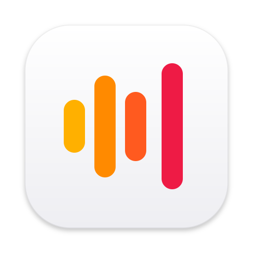
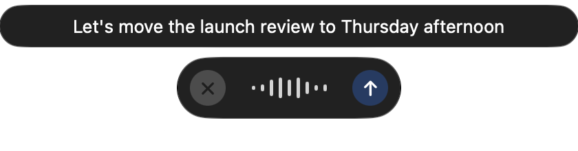
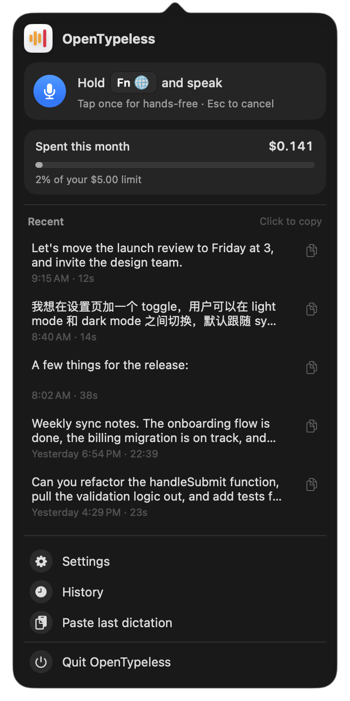
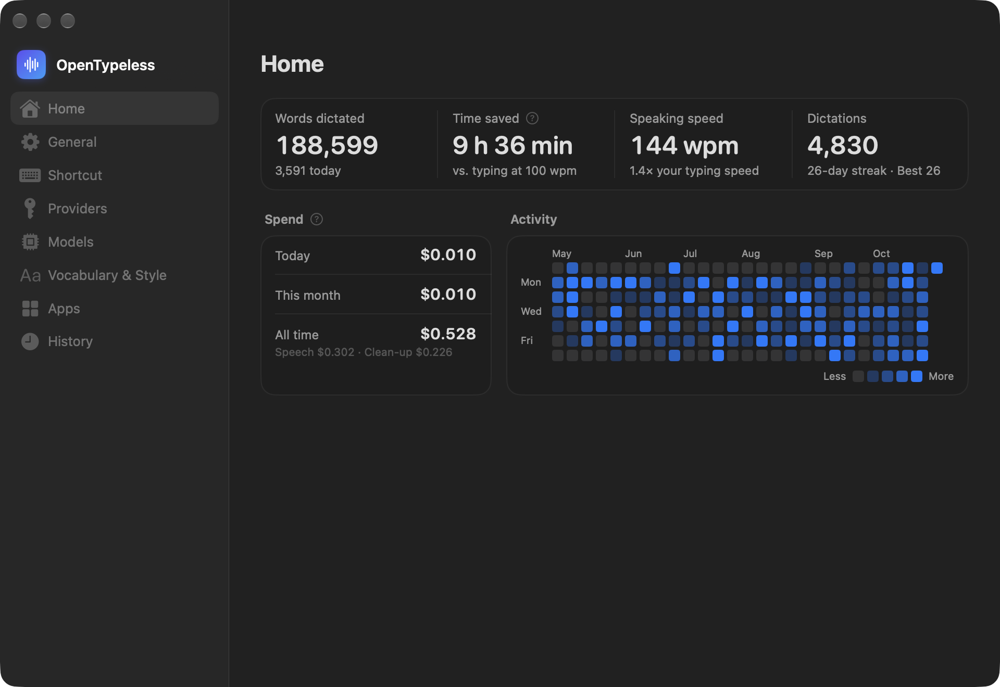
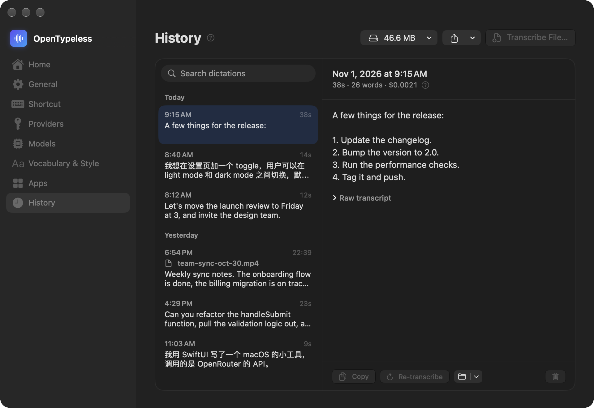
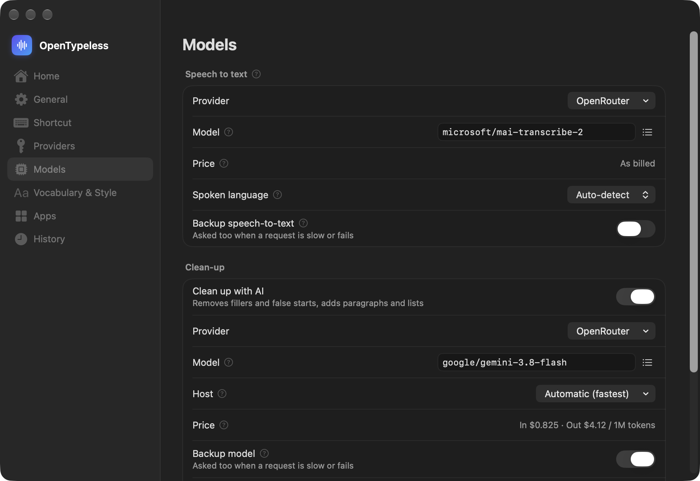
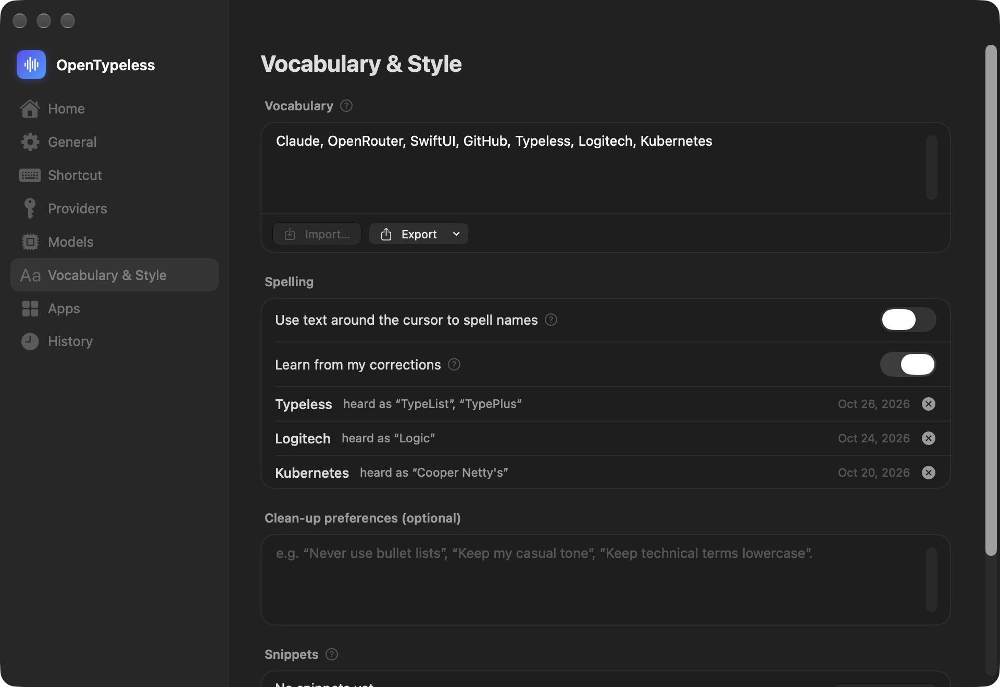

<p align="center">
  <b>English</b> · <a href="README.zh-CN.md">简体中文</a> · <a href="README.ja.md">日本語</a> · <a href="README.ko.md">한국어</a> · <a href="README.es.md">Español</a> · <a href="README.pt-BR.md">Português</a> · <a href="README.fr.md">Français</a> · <a href="README.de.md">Deutsch</a> · <a href="README.ru.md">Русский</a>
</p>

<p align="center">
  
</p>

<h1 align="center">OpenTypeless</h1>

<p align="center">
  <b>Hold a key, talk, and get clean text at your cursor.</b><br>
  Native voice typing for macOS and Windows, built for long dictation.
</p>

<p align="center">
  <a href="https://github.com/Tyler913/OpenTypeless/releases/latest"><b>Download</b></a> · <a href="#install">Install</a> · <a href="docs/DEVELOPMENT.md">Build from source</a>
</p>

<p align="center">
  
</p>

## Why OpenTypeless

Most voice-typing apps handle a sentence fine and fall apart on a two-minute ramble: timeouts, empty results, lost text. OpenTypeless is built for exactly that.

- **Talk as long as you like.** Audio is cut at your pauses and transcribed while you speak, so even a long dictation is ready moments after you let go.
- **Never lose a word.** Each segment retries on its own, a slow model gets a backup, and every recording is saved so a failed one can be retried.
- **Reads like you typed it.** Fillers and false starts disappear, “Wednesday, no, Thursday” becomes Thursday, and lists become lists. Your wording, numbers and languages stay.
- **Bring your own key.** OpenRouter, OpenAI, Groq, Gemini, Anthropic, DeepSeek and more, or local models with Ollama and LM Studio. No account, no server of its own.

<p align="center">
  
</p>

## Features

- **Push-to-talk or hands-free.** Hold **Fn** (macOS) or **Right Alt** (Windows), or tap once to keep going. Any key or combination works.
- **Translate as you speak.** Add **Shift** and your words come out in the language you picked.
- **Edit by voice.** Select text, add **Ctrl**, and say “make it more formal” or “turn this into a list”.
- **Vocabulary that learns.** Add names and jargon; words you correct after pasting are learned automatically.
- **Learns how you write (optional).** Your punctuation and tone, learned from your dictations and edits into a short note you can edit.
- **Snippets.** Say “my email” and your saved text goes in, word for word.
- **Scratchpad.** A notepad to dictate into, where a dictation with nowhere to go is kept too.
- **Clean-up your way.** Off, Light, Standard or Polished, preset for chat, mail and code apps. Per app you can also press Return after inserting, as in Slack.
- **History and files.** Every dictation is searchable, exportable and can be played back, and audio or video files can be transcribed too.
- **Know your spend.** Words, time saved and cost on the Home page, with an optional monthly limit.
- **On-device, no key needed.** Speech-to-text can run on your computer instead: free, offline and private, a little less accurate than cloud models. It also takes over when you're offline.
- **Live preview (beta).** See your words above the capsule while you talk.
- **Nine languages, automatic updates.** English, 简体中文, 日本語, 한국어, Español, Português, Français, Deutsch, Русский.

<table>
  <tr>
    <td width="50%" align="center"><br><sub>Home: words, time saved, spend and activity</sub></td>
    <td width="50%" align="center"><br><sub>History: every dictation, searchable</sub></td>
  </tr>
  <tr>
    <td width="50%" align="center"><br><sub>Models: a provider and model for each step</sub></td>
    <td width="50%" align="center"><br><sub>Vocabulary, including words learned from your fixes</sub></td>
  </tr>
</table>

<sub>Screenshots are from macOS. Windows has the same pages, in its own native look.</sub>

## Install

### macOS

Needs macOS 26 or later, on Apple silicon or Intel.

```bash
brew install --cask tyler913/tap/opentypeless
```

Or download the `.dmg` from [Releases](https://github.com/Tyler913/OpenTypeless/releases) (`arm64` for Apple silicon, `x64` for Intel) and drag the app into Applications. It isn't notarized by Apple, so if macOS says it can't be opened or “is damaged”, run this once:

```bash
xattr -dr com.apple.quarantine /Applications/OpenTypeless.app
```

### Windows

Needs Windows 10 (2004 or later) or Windows 11, x64 or ARM64.

Download `OpenTypeless-<version>-windows-x64-setup.exe` (`arm64` for Windows on ARM) from [Releases](https://github.com/Tyler913/OpenTypeless/releases) and run it; no administrator rights needed. If SmartScreen appears, click **More info → Run anyway**. The `.zip` is a portable version.

After that, the app updates itself.

## Get started

1. Open OpenTypeless. It lives in the menu bar (macOS) or the notification area (Windows).
2. The welcome guide asks for an API key. [OpenRouter](https://openrouter.ai/keys) is the easiest: one key covers everything. Or choose **Use on-device recognition** to start with no key at all.
3. On macOS, allow **Microphone** and **Accessibility** when asked.
4. Hold the shortcut, talk, and let go. The text appears at your cursor.

> On macOS, set **System Settings → Keyboard → “Press 🌐 key to”** to **Do Nothing**, so tapping Fn doesn't open the emoji picker.

## Privacy

- Audio and text go only to the providers you set up. Besides that, the app only checks GitHub for updates once a day and downloads OpenRouter's public price list. Live preview on Windows uses Windows speech recognition, which follows its own online setting.
- Keys, settings and history stay on your computer. Recordings are kept for a month by default; you choose how long.
- Password fields are never read. Using the text around your cursor to spell names is off unless you turn it on.

## Development

Two native apps in one repository: [`macos/`](macos) in Swift / SwiftUI and [`windows/`](windows) in C# / WinUI 3, with the same pipeline, clean-up prompt and settings. See [docs/DEVELOPMENT.md](docs/DEVELOPMENT.md) to build and test them, and [docs/DESIGN.md](docs/DESIGN.md) for how they work.

## Acknowledgements

Inspired by Typeless. The system-integration approach learned from the open-source [VoiceInk](https://github.com/Beingpax/VoiceInk), [OpenLess](https://github.com/Open-Less/openless) and [OpenTypeless (tover0314-w)](https://github.com/tover0314-w/opentypeless). This project is independent and not affiliated with any of them. On-device recognition on Windows runs [SenseVoice Small](https://github.com/FunAudioLLM/SenseVoice) (FunASR Model License) with [sherpa-onnx](https://github.com/k2-fsa/sherpa-onnx) (Apache-2.0).

## License

[MIT](LICENSE)
