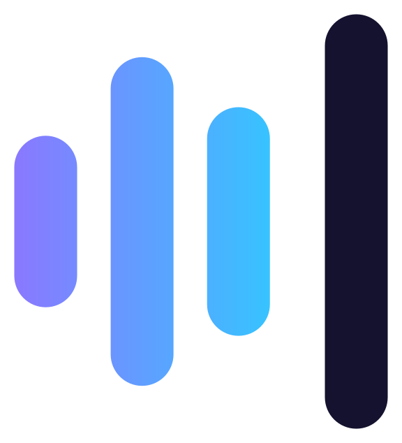
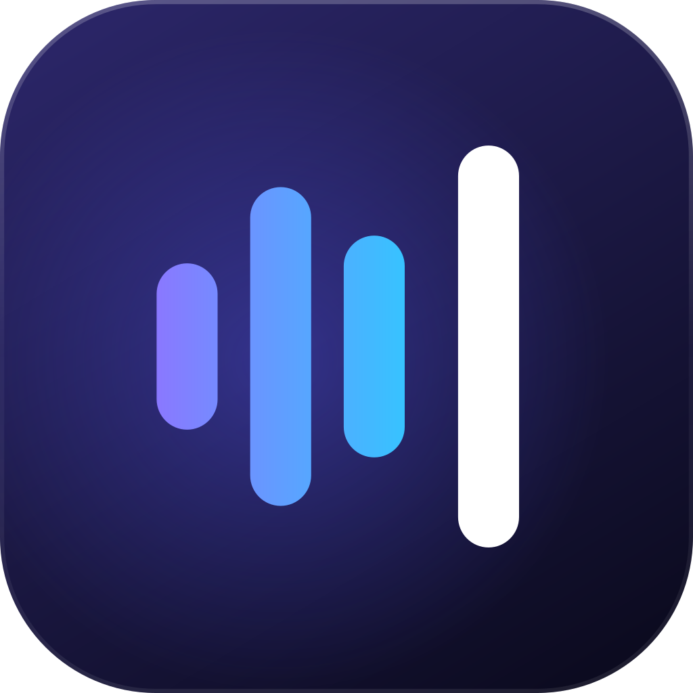

# OpenTypeless logo

  
  &nbsp;&nbsp;&nbsp;&nbsp;
  

**Voice → caret.** Three voice bars run into a text caret: what you say becomes text at your cursor. The bars step
from amber through tangerine to vermilion as the voice warms up; the caret, the tallest stroke and set a little apart,
is crimson. It is four round-ended strokes of one width and nothing else, so it reads the same from a 16 px tray icon
to a 1024 px Dock icon.

The mark stands on its own, with no tile: every colour holds on white and on black. The macOS icon puts it on a white
tile, like text on a page; Windows uses the bare mark, since Windows icons carry their own silhouette rather than sit
on a plate.

## Files

| File | Use |
|---|---|
| [`mark.svg`](mark.svg) | The logo: the mark alone, no tile. Light or dark backgrounds, README, website, print. |
| [`app-icon.svg`](app-icon.svg) | The mark on its white tile: app stores, social cards, anywhere an app icon is expected. |
| [`mark-mono.svg`](mark-mono.svg) | One colour (`currentColor`), the bars at half strength: like the menu-bar and tray icons. |

Every file here and every app icon (`macos/Resources/AppIcon.icns`, `windows/src/OpenTypeless/Assets/AppIcon.ico`
and their PNGs) is written by [`scripts/make_icon.py`](../../scripts/make_icon.py), which holds the geometry and
colours. Change the artwork there, run `python3 scripts/make_icon.py`, and update the in-app copies to match:
`Logo` in `macos/Sources/OpenTypeless/DesignSystem.swift` and in `windows/src/OpenTypeless/UI/DesignSystem.cs`
(the tiles, the macOS menu-bar icon and the Windows tray icon draw from those).

## Colours

| | Hex |
|---|---|
| Amber (bar 1) | `#FFB000` |
| Tangerine (bar 2) | `#FF8A00` |
| Vermilion (bar 3) | `#FF5A1F` |
| Crimson (caret) | `#EE1B45` |
| Tile | `#FFFFFF` to `#EEEEF2`, top to bottom, with a 7 % black hairline inside the edge |

Each stroke is one flat colour; there are no gradients inside the mark.

## Geometry

In tile units (0 to 1 across the tile). Every stroke is 0.104 wide, round-ended and centred on y = 0.5.

| | Centre x | Height |
|---|---|---|
| Bar 1 | 0.245 | 0.26 |
| Bar 2 | 0.395 | 0.50 |
| Bar 3 | 0.545 | 0.34 |
| Caret | 0.725 | 0.62 |

The bars sit 0.150 apart and the caret 0.180 from the last bar. The mark is centred 0.015 left of the tile's centre
to balance the caret. The tile's corner radius is 0.225 of its width; on macOS the tile is 824 px on the 1024 px
canvas (Apple's icon grid) with a soft drop shadow. In the bare Windows icon the caret is 88 % of the canvas tall.

## Use

- Keep clear space around the mark of at least one bar pitch (0.150 of the tile).
- Keep the colours in order, amber to crimson, left to right; keep the caret the tallest stroke.
- Don't put the coloured mark on orange or red backgrounds; use the one-colour version in white there.
- Don't add a microphone, a speech bubble or an outline, and don't stretch, rotate or re-space the strokes.
